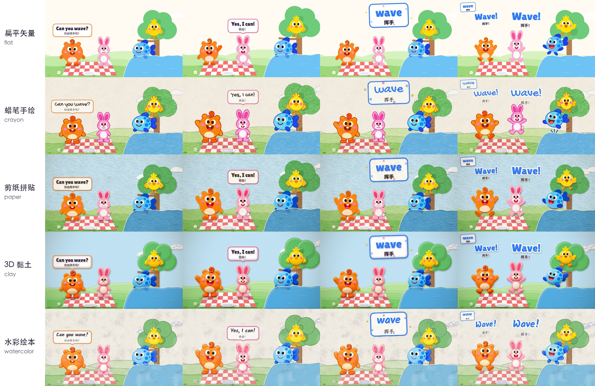

# Kids English Video

`kids-english-video` 是一个 Claude Code skill，用来做给 3–6 岁孩子看的英语启蒙动画短片。横屏 1920×1080，一集两三分钟：一个句型反复问答、单词卡、领念跟念、留空拍让孩子开口答、片尾再见。



## 一集的结构

以示范集《Do You Like Carrots?》（约 139 秒）为例：

| 段 | 内容 |
|---|---|
| 片头 | 标题字母一个个掉下来，主角 Bobo 打招呼，引出场景 |
| 3–4 轮问答 | Bobo 问一个动物两遍，动物回答；老师（不出镜）念单词，单词卡弹出；动物领念 3 遍，再和 Bobo 齐念 3 遍。每轮换一个单词、一个动物 |
| 反转 | 动物们反过来问 Bobo，先说 No，再被说服变成 Yes，顺便练否定回答 |
| 跟读 | 老师提问，留 3 拍空白（画面出"轮到你说！"和节拍点），然后 Bobo 给标准答案。最后一题故意问个荒唐的，答 No |
| 片尾 | 全员挥手 Bye-bye |

所有台词都卡在同一个节拍上（默认 100 BPM），伴奏也用这个节拍。口型按配音响度逐帧切换。

## 画风和配乐

画风五选一：`flat` 扁平矢量、`crayon` 蜡笔手绘、`paper` 剪纸拼贴、`clay` 3D 黏土、`watercolor` 水彩绘本。每种画风都带 4 个角色的基础帧（闭嘴、半张、大张嘴、挥手、大笑、欢呼）和设定稿，扁平风另有前两集的吃、跳、跑等动作帧。

配乐五选一：`ukulele` 尤克里里、`musicbox` 音乐盒、`march` 玩具进行曲、`chiptune` 8-bit、`none` 不要。

## 用到的工具

1. 角色和物品图：Codex 生图，品红底，再用脚本切图、去边、统一身高、按下半身对齐
2. 配音：Fish Audio 公共音色（`s2.1-pro-free`），每条按音色和文字缓存
3. 画面：Canvas 代码逐帧渲染，Playwright 无头浏览器分段并行出帧
4. 音效和伴奏：Python 代码合成
5. 混音：FFmpeg，响度 -16 LUFS

## 安装

```bash
git clone https://github.com/lwmxiaobei/xiaobei-skills.git
cp -R xiaobei-skills/kids-english-video ~/.claude/skills/kids-english-video
```

在 Claude Code 里直接说要做哪一集即可，例如：

```text
/kids-english-video 做一集 Can you jump?，蜡笔风，玩具进行曲
```

## 环境要求

1. macOS（生图脚本 `template/角色/gen_img.sh` 用 zsh）
2. Python 3 和 `uv`：新建项目时会建 Python 3.12 虚拟环境，装 numpy、scipy、pillow、msgpack
3. FFmpeg
4. Node.js：用 `npx @openai/codex` 生图，需要本机 Codex 已登录
5. Fish Audio API key：设环境变量 `FISH_AUDIO_API_KEY` 或 `FISH_API_KEY`

注意：配音脚本 `template/fishvoice.py` 读 API key 的函数是从 `manim-explainer-video` skill 导入的（`~/.claude/skills/manim-explainer-video/scripts/fish_tts.py`），那个 skill 不在本仓库里。没有装它的话，把 `fishvoice.py` 里的 `api_key(...)` 换成直接读环境变量即可。

## 快速开始

新建一集：

```bash
python3 ~/.claude/skills/kids-english-video/scripts/new_episode.py ~/videos/2026-11-06-can-you-jump \
  --style crayon --music march --grammar canyoujump \
  --title "Can You Jump?" --title-zh "你会跳吗？"
```

想先跑通一遍流程，用 `--example` 原样复制示范集（扁平风，素材齐全）。

之后在项目目录里依次运行：

```bash
.venv/bin/python tts.py            # 配音
.venv/bin/python build.py          # 卡拍点，出人声、口型、画面 spec
.venv/bin/python render_all.py --jobs 4   # 渲染画面
.venv/bin/python assemble.py       # 混音、加伴奏
```

成片在 `out/成片.mp4`，另有不带伴奏的 `out/成片_无背景音乐.mp4`。扁平风整集约 70 秒渲完，其他画风约 8–10 分钟。

台本写法、生新图、写本集画面这几步要按 `SKILL.md` 和 `references/` 里的说明来，由 Claude 执行。

## 文档

1. [执行流程](SKILL.md)
2. [台本格式](references/script-format.md)
3. [角色和画风](references/characters.md)
4. [画面库 API](references/scene-cookbook.md)
5. [配乐](references/music.md)
6. [踩过的坑](references/pitfalls.md)

## 字体授权

`template/代码工程/lib/fonts/` 下的字体都是 SIL Open Font License 1.1，见同目录的 `LICENSES.md` 和 `OFL.txt`。
